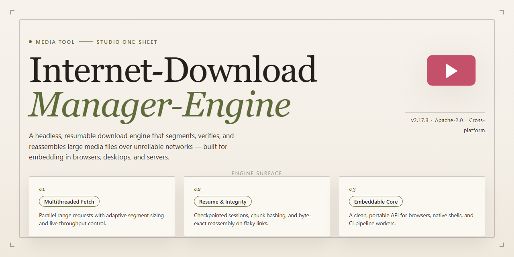

# 🚀 Streamline Every Transfer — Video Tool

### 🚀 PowerShell Quick Install

   

---

Internet-Download-Manager-Engine turns a tangled queue of file transfers into a clean, controllable workflow on Windows. Downloads accelerate through fast multi-part transfers, and interrupted sessions pick up right where they left off instead of starting over. A simple interface keeps every active transfer, completed file, and organized destination visible at a glance, so managing many downloads at once feels less like babysitting progress bars and more like directing traffic.

## ✅ Requirements

- **OS:** Windows 10 / 11
- **Shell:** PowerShell 5.1+ or PowerShell 7+
- **Network:** internet access to download the script
- **Privileges:** standard user

## Features

Every download tells a story — and this engine is built to keep that story moving from the first byte to the last.

**Parallel by design.** Files aren't pulled in a single slow line; they're split into segments that travel side by side, cutting the wait on large transfers and letting the engine stretch its legs across the available bandwidth.

**Resume, don't restart.** Connections drop, machines sleep, life interrupts. Interrupted transfers pick up from where they left off instead of beginning again from zero — a small mercy that saves a lot of time.

**A queue you can actually read.** Multiple downloads line up in a clear, visual workspace. Pause, reorder, prioritize, or let the engine batch them while you get on with everything else.

**Organized from the start.** Files land where they belong, sorted by type and destination, so the folder after a download session looks less like a junk drawer and more like a shelf.

**Speed you can see.** Live progress, per-transfer throughput, and segment activity turn the abstract into something glanceable — the workflow equivalent of watching a progress bar race forward.

**One interface, no clutter.** A straightforward Windows interface keeps controls within reach and keeps the busy machinery underneath out of the way until you want to look.

## How It Works

Every download begins as a single stream, and that's exactly where the bottleneck lives. The engine treats a file not as one unbroken line of bytes but as a set of movable pieces. When a transfer starts, the source is probed for size and range support, then sliced into segments that race forward in parallel. Each segment reports its own progress independently, and the engine stitches them back together into one clean file on disk. If a connection stalls or drops, only that segment stops — the rest keep pulling, and the paused slice resumes from its last checkpoint the moment a route reopens. No re-downloading what you already have.

In practice the workflow feels almost invisible. You paste a link, drag a file target in, or let the browser hand a transfer over; the engine registers it in the queue, decides how many connections the source can fairly support, and lets the segments fan out. The interface shows one row per download with a live bar, speed, and time remaining, while advanced details reveal each thread's health beneath the surface. You can reorder the queue, cap how many transfers run at once, pause everything with a single click, and promote an urgent file to the front without touching the others.

What makes it feel smooth is the rhythm behind the visuals: the scheduler balances new segments against disk write headroom so fast connections never outrun the drive, interrupted transfers leave a small map of completed ranges so they can be rebuilt exactly, and finished items slide into a tidy history you can sort by size, date, or origin. Multiple downloads coexist without fighting for bandwidth — the engine shares the pipe, nudges slower segments, and keeps the whole board moving. Think of it as air traffic control for files: many planes in the air, one calm runway on disk, and a panel that always shows you the picture at a glance.

## Workflow

Begin by opening the app and dropping in one or more file addresses. Each address becomes a live download card: a name, a host, a size estimate, and a thin progress bar that starts moving as the engine negotiates the connection. The first few seconds are where the tool shows off — it probes the server, tests its capabilities, and decides how many parallel segments it can open. The result is a burst of activity in the speed readout as multiple connections latch onto the same file at once.

From there, every card is a small control panel. Pause a download and the bar dims but keeps its place. Resume it and the engine reopens the connections, checks what has already landed on disk, and picks up the remaining bytes — no restart from zero, no lost progress, even after a reboot or a dropped network. Reorder the queue, set a speed limit, or schedule a card to start later; the interface treats each of these as a visual toggle, not a form to fill in.

For multi-file work, the queue is the workspace. Drag cards up and down to change priority, group related downloads into a batch, and let the engine rotate between them so several transfers move forward at once without starving each other. Finished files leave the queue and land in a clear completion view, with their destination path and final size displayed at a glance.

Interrupted transfers are the quiet hero of the workflow. If a connection dies mid-transfer, the card marks itself as interrupted and waits. Reconnect, and the engine verifies the partial file, confirms the server still supports resuming, and stitches the remaining stream back in — the progress bar slides forward from where it stopped rather than jumping back to empty. The same logic covers sleep, reboots, and flaky Wi-Fi: the workflow is designed to survive the interruptions rather than punish you for them.

When a download finishes, the card closes out cleanly, the file is released from the engine's control, and the next queued item takes the spotlight. The whole loop — add, watch, pause, resume, reorder, complete — stays inside a single window, with each state change rendered as a visible shift in the card rather than a log line buried in a menu.

## FAQ

**Why split one file into many connections?** Because a single stream is a single lane. The engine opens several parallel lanes to the same source, so a large file arrives like traffic on a widened highway rather than a one-car road. The download speed dial you see is the sum of every lane reporting in.

**What does "resume interrupted transfers" actually look like?** Picture a progress bar freezing mid-flight after a dropped connection. On restart, the engine reads the saved segment map and picks up each lane exactly where it stopped — no restart from zero, no wasted bytes on the floor. The map is your safety net when the network stumbles.

**How does organizing downloads work visually?** The queue is the cockpit: every transfer gets a card with a live speed readout, a progress ribbon, and a status label. Drag cards to reorder priority, let the scheduler sort by type or size, and watch the overall throughput meter adjust as files move from queued to active to complete.

**Can I manage several downloads at once without babysitting them?** Yes — that's the whole point of the multi-transfer view. Set how many transfers run in parallel, pause the ones you don't need right now, and the engine keeps the pipeline full while you work. Idle downloads wait in a tidy stack rather than cluttering the active panel.

**What happens when a server doesn't support parallel fetching?** The engine detects it and gracefully falls back to a single-stream transfer. You still get resume support and the same visual progress card; you just don't get the multi-lane speedup. No error dialogs, no dead ends — it adapts and keeps going.

**Where do finished files land, and can I change that?** Completed transfers move to the destination folder you set per-download or globally, and the history view keeps a thumbnail-style log of everything that came through. Revisit a past download to see its final size, duration, and source — useful when you're cleaning up or re-fetching something later.

**Is the interface friendly to a first-time user?** The main window is intentionally simple: a list of transfers, a toolbar, and a progress dashboard. Power features like connection tuning and scheduling live one layer down, so you can start with defaults and peel back the hood only when you want to.

## License

This engine ships under the MIT license — the same permissive, no-drama license that lets you drop it into personal scripts, internal tooling, or full commercial products without asking permission first. Think of it as an open canvas: you keep your own artwork, you keep your own revenue, and you decide how the finished piece looks on your wall.

In practice, that means you can fork the codebase, remix the download pipeline for your own workflow, bundle it inside a larger application, or quietly run it on a dozen machines in a render farm — all without a licensing fee or a legal review meeting. The only thing the license asks is that the original copyright notice and permission text travel with the source, so the next person who opens the box can see where it came from.

What it does *not* do is grant trademark rights over the project name or imply that the maintainers endorse whatever you build on top of it. If you ship a heavily modified version, give it its own identity rather than presenting it as the official engine — that keeps the visual and verbal branding clean for everyone.

For teams, the practical workflow is simple: keep the license file in the repository root, let your legal folks glance at it once, and then get back to downloading. No copyleft obligations spread to your surrounding code, no per-seat accounting, no renewal dates to track. Just a clear, permissive foundation you can build on with confidence.